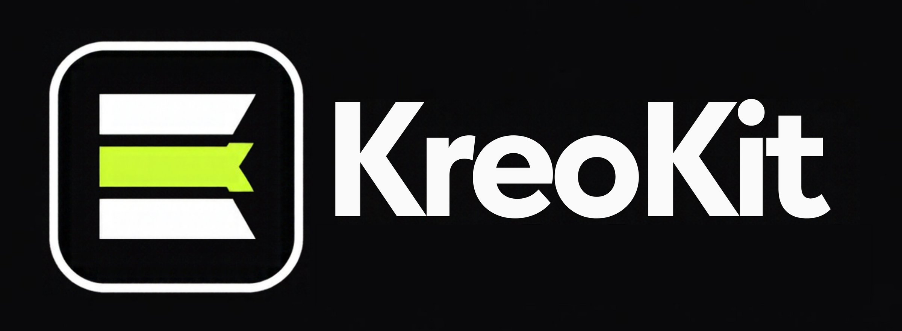

<p align="center">
  
</p>

# KreoKit Rec

**Free, offline screen and camera recorder.** Record your screen, camera and microphone for tutorials, demos and reaction videos, trim the ends, place your camera bubble, clean up your voice and export a ready-to-share MP4, with no account and no upload.

Part of [KreoKit](https://github.com/kreokit), free open-source creator tools.

> **Status:** alpha. Download it from [Releases](https://github.com/kreokit/rec/releases) (macOS, Windows, Linux).

## What it does

- **Record** the whole screen, a region or a window, with your camera and microphone (and the computer's sound on macOS 13+, Windows and Linux), at 1080p or 720p, 30 fps. Every source is its own crash-safe track: a crash keeps everything up to the last second or two, and Rec offers to recover it.
- **While recording:** a 3-2-1 countdown, a small floating control, your camera in a bubble, and a stop shortcut from any app (⌥⇧⌘S / Ctrl+Alt+Shift+S). Rec's own windows stay out of the video where the system allows it.
- **Finish:** trim the ends, choose screen only, screen + camera bubble or camera only, clean up your voice (RNNoise) and set the loudness (−14 or −16 LUFS).
- **Export** an MP4 (H.264 + AAC), checked after writing; nothing is overwritten without asking.

Unsigned alpha, measured on one Mac so far: see the release notes for what is tested and how to open it the first time.

## Development

Needs Node 22+, pnpm 10, Rust (stable) and the [Tauri 2 prerequisites](https://tauri.app/start/prerequisites/).

```bash
pnpm install
pnpm tauri dev       # the app, with the interface on http://localhost:1490
pnpm test            # interface tests
cd src-tauri && cargo test
```

## Licence

KreoKit Rec is dual-licensed under [MIT](LICENSE-MIT) or [Apache-2.0](LICENSE-APACHE), at your option. Third-party components and their licences are listed in [THIRD-PARTY-LICENSES.md](THIRD-PARTY-LICENSES.md).
